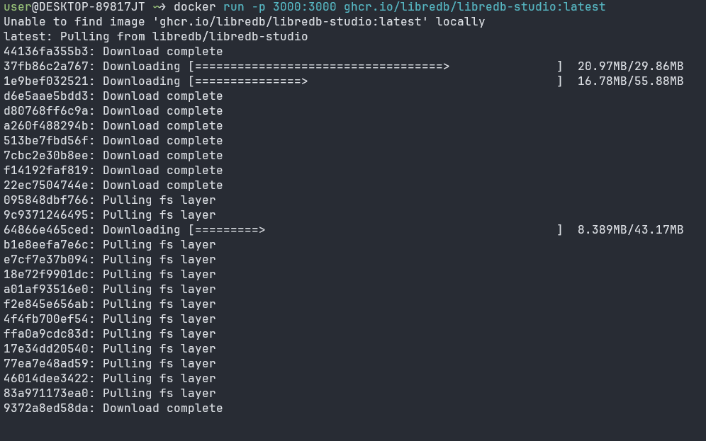
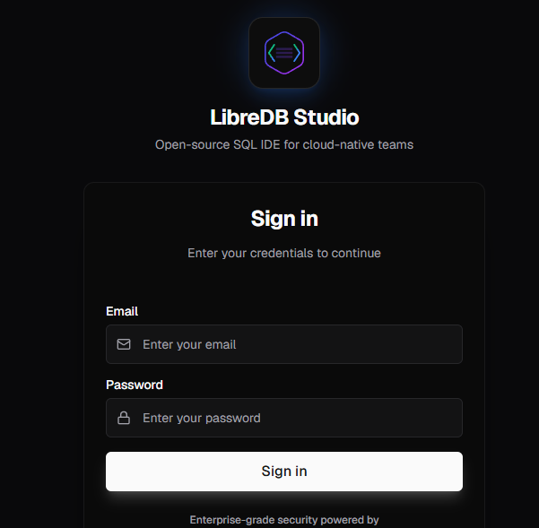
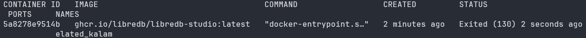
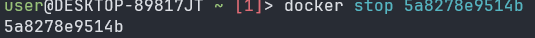
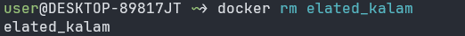
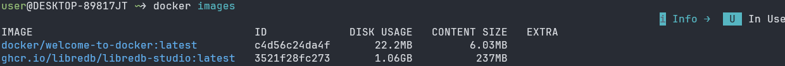
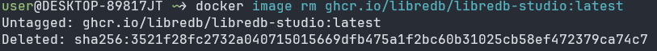

## LibreDB Studio

**LibreDB Studio** — это открытая (MIT-лицензия) веб-IDE для работы с базами данных, которая разворачивается как контейнер Docker рядом с самой базой, а не на машине разработчика. По сути, это «браузерный DataGrip/DBeaver» — единая точка входа для запросов, визуализации и администрирования

    Вместо того чтобы каждый разработчик устанавливал десктопное приложение и искал строки подключения, вы разворачиваете один контейнер на сервере (или в облаке) рядом с базой. Пользователи заходят через браузер — включая мобильные устройства, что актуально для «горящих» запросов

> **Это задание лучше выполнять в WSL или в другом полноценном Linux!**

- > Никогда в разработке не используйте русские имена файлов и каталогов!
- > Никогда в разработке не используйте пробелы и спец.символы в именах файлов и каталогов!
- > Перед созданием проекта убедитесь, что порт 8084 не занят другим приложением!
- > Создание проекта лучше начать с "чистого листа", предварительно остановив и удалив все другие контейнеры и образы!

### 1. Создание и запуск LibreDB Studio

```shell
docker run -p 3000:3000 ghcr.io/libredb/libredb-studio:latest
```


в консоле вы увидите сгенерированные автоматически e-mail и пароль, которые введёте в Sing In интерфейса приложения в [браузере http://localhost:3000](http://localhost:3000)



или с заданными заранее e-mail и пароль (Git-Bash/Linux)
```shell
docker run -d \
  --name libredb-studio \
  -p 3000:3000 \
  -e ADMIN_EMAIL=admin@example.com \
  -e ADMIN_PASSWORD=YourStrongPassword \
  -e JWT_SECRET=your-random-32-char-secret-string \
  ghcr.io/libredb/libredb-studio:latest
```
где `admin@example.com` и `YourStrongPassword` ваши email и пароль

Обезятельно задайте вопрос Ai-боту - "Что ты умеешь?"!

Чтобы выйти из проекта в консоле, выполните `Ctrl+C`

### 2. Удалить проект

Получаем имя
```shell
docker ps -a
```



останавливаем его, если запущен
```shell
docker stop имя_контейнера
```



удаляем контейнер
```shell
docker rm имя_контейнера
```



получаем имя образа
```shell
docker images
```



и удаляем
```shell
docker image rm ghcr.io/libredb/libredb-studio:latest
```



### Полезные ссылки

- [LibreDB Studio - анонс новой версии](https://www.opennet.ru/opennews/art.shtml?num=66216)

> Если вы обнаружили ошибку в этом тексте - сообщите пожалуйста автору!