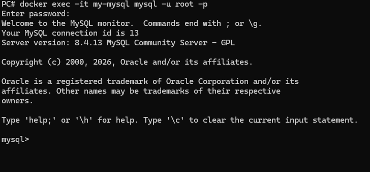
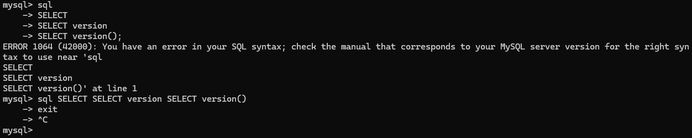

## MySQL база данных

- > ## Для выполнения этого задания используйте WSL или любой другой Linux или Mac!

Выполните все этапы работы с проектом по примеру с [Nginx](/content/Docker/ImageLibrary/Nginx.md)

- > Никогда в разработке не используйте русские имена файлов и каталогов!
- > Никогда в разработке не используйте пробелы и спец.символы в именах файлов и каталогов!
- > Перед созданием проекта убедитесь, что порт, который собираетесь использовать не занят другим приложением!
- > Создание проекта лучше начать с "чистого листа", предварительно остановив и удалив все другие контейнеры и образы!

### 1. Подготовка

> **Создание проекта лучше начать с "чистого листа", предварительно остановив и удалив все другие контейнеры и образы!**

Перед выполнением этого задания рекомендуется завершить и удалить все имеющиеся учебные контейнеры:

Остановить все запущенные контейнеры:
```shell
docker stop $(docker ps -q)
```
Удалить все остановленные или не запущенные (Exited, Created) учебные контейнеры:
```shell
docker container prune
```
> **Prune** — удаляйте ненужные контейнеры, чтобы не засорять ваш Docker!

Или так удалить все учебные контейнеры (включая запущенные — принудительно):
```shell
docker rm -f $(docker ps -aq)
```
Очистить все ненужные (учебные) тома:
```shell
docker volume prune -a
```
Опционально: можно удалить образы и кеш сборок в Docker

Удаление всех образов
```shell
docker image prune -a
```
Очистить кэш всех сборок:
```shell
docker builder prune -a
```

- [Подробней про управление Docker в шпаргалке](/content/Docker/DockerReminder.md)

***

### 2. Получение образа, создание и запуск контейнера

1. Запуск **MySQL**

**Git-Bash/Linux/WSL 2.0/Mac**:
```shell
docker run -d \
  --name my-mysql \
  -p 3306:3306 \
  -e MYSQL_ROOT_PASSWORD=rootpassword \
  -e MYSQL_DATABASE=mydb \
  -e MYSQL_USER=user \
  -e MYSQL_PASSWORD=password \
  mysql:8
```
2. Подключиться
```shell
docker exec -it my-mysql mysql -u root -p
```



> Пароль: rootpassword

### 3. Выполнить несколько команд в базе дыннх **SQL** для проверки

Получить список баз данных:
```sql
sql
```
Получить версию:
```sql
SELECT version();
```
выйти из БД
```sql
exit
```



**Результат оформить в виде отдельного `README.md` со скриншотами результатов ваших действий и прислать ссылку преподавателю.**

> Если вы обнаружили ошибку в этом тексте - сообщите пожалуйста автору!