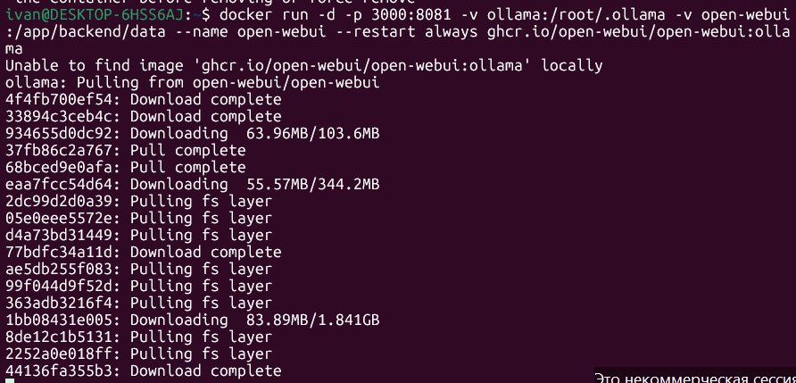
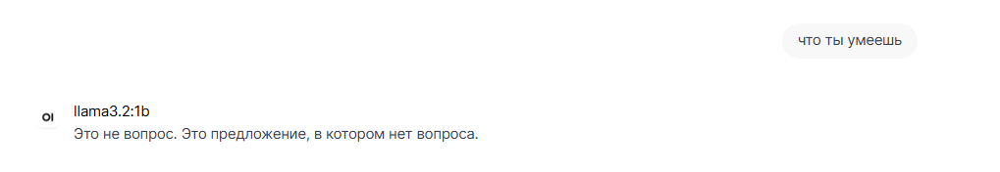
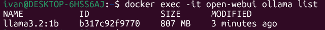

## Запуск Ollama в контейнере

> **Это задание лучше выполнять в WSL или в другом полноценном Linux!**

- > Никогда в разработке не используйте русские имена файлов и каталогов!
- > Никогда в разработке не используйте пробелы и спец.символы в именах файлов и каталогов!
- > Перед созданием проекта убедитесь, что порт 8084 не занят другим приложением!
- > Создание проекта лучше начать с "чистого листа", предварительно остановив и удалив все другие контейнеры и образы!

### 1. Ollama+phi4

Получить ollama:
```shell
docker run -d -v ollama_data:/root/.ollama -p 11434:11434 --name ollama ollama/ollama
```
```shell
docker exec -it ollama ollama run phi4
```
выйти из командного режима нейросети:
```shell
/exit
```
и
```shell
/bye
```

---

### 2. Open WebUI и Ollama

```shell
docker run -d -p 3000:8081 -v ollama:/root/.ollama -v open-webui:/app/backend/data --name open-webui --restart always ghcr.io/open-webui/open-webui:ollama
```



[Открыть чат в браузере](http://localhost:3000)
или
[Открыть чат в браузере](http://0.0.0.0:3000)


или через другой порт:
```shell
docker run -d -p 8081:8080 \
  -v ollama:/root/.ollama \
  -v open-webui:/app/backend/data \
  --name open-webui \
  --restart always \
  ghcr.io/open-webui/open-webui:ollama
```
[Открыть чат в браузере](http://localhost:8081)


Задать вопрос нейросети:



показать установленные модели:
```shell
docker exec -it open-webui ollama list
```

